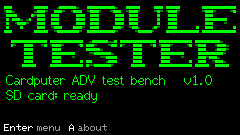
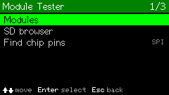
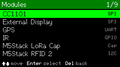
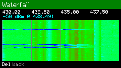
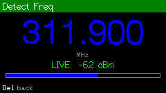
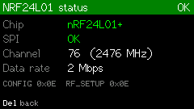

# Module Tester

A menu-driven test bench for the **M5Stack Cardputer ADV** (ESP32-S3) that lets you wire up and
test M5Stack and third-party modules — radios, displays, GPS, RFID, IR, and audio.

 

## Features

- **Modules menu** — pick a unit and run its dedicated test screen:
  - **CC1101** — Waterfall, Detect Freq, raw chip status, pin finder
  - **NRF24L01** — chip status, 2.4GHz spectrum scan, pin finder
  - **PN532** — NFC/RFID read
  - **M5Stack RFID 2** — card read/test
  - **GPS** — live fix display
  - **IR** — capture, replay and manage IR signals (Flipper `.ir` format)
  - **M5Stack LoRa Cap** — LoRa + onboard GNSS
  - **External Display** — SPI display pin test, colour fills, Matrix rain and starfield test patterns
  - **Speaker** — plays RTTTL melodies (preloaded tune + your own `.fmf` files from SD), tone sweep, volume control, through the Cardputer ADV's onboard ES8311 codec
- **SD card browser** — browse and manage files on the card directly from the device
- **Find chip pins** — scans the shared SPI bus's spare GPIOs to help locate an unlabelled chip's wiring
- **Screenshot capture** — `Fn+S` from anywhere saves a BMP of the current screen to the SD card
- **Per-module pin configuration** — remembered on the SD card, no recompiling to change wiring

## Screenshots

| | |
|---|---|
|  |  |
|  |  |
|  |  |

## Hardware

- M5Stack Cardputer ADV (ESP32-S3)
- microSD card (required for file storage, screenshots, and some module features)
- Whichever test modules you want to try: CC1101, NRF24L01, PN532, GPS, RFID 2, LoRa Cap, an SPI
  display, etc. Pins for each are configurable on-device.

## Building

This is a [PlatformIO](https://platformio.org/) project (Arduino framework).

1. Install [VS Code](https://code.visualstudio.com/) and the PlatformIO IDE extension
2. Clone this repository and open the folder in VS Code
3. Select the `m5stack-stamps3` environment and build/upload

```sh
git clone <your-repo-url>
cd cardputer-module-tester
pio run -t upload
```

Debugging is via the serial monitor at `115200` baud.

## SD card layout

```
/ModuleTests/
  ir/      saved IR signals     (.ir,  Flipper format)
  rfid/    saved cards          (.rfid, simple text)
  music/   RTTTL melodies       (.fmf, "name:d=..,o=..,b=..:notes")
  screenshots/   saved screen captures (Fn+S)
```

## Credits

Thanks to:
- [Unigeek](https://github.com/lshaf) — CC1101 reference
- [Bruce Firmware](https://github.com/BruceDevices)
- [Claude Desktop Buddy](https://github.com/anthropics/claude-desktop-buddy)
- [Flipper-IRDB](https://github.com/Lucaslhm/Flipper-IRDB) — IR files
- [UberGuidoZ](https://github.com/UberGuidoZ/) — Flipper FMF files

## License

MIT License

---

Created by **Fr4nx40** — [github.com/fr4nx40](https://github.com/fr4nx40)
